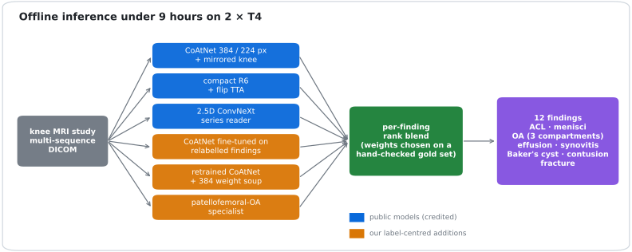
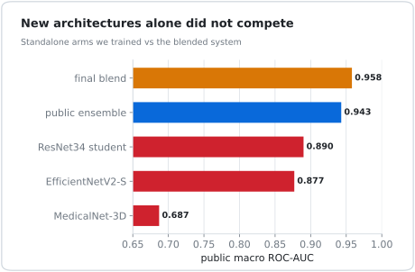
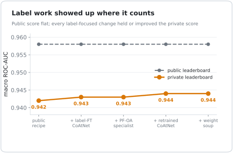
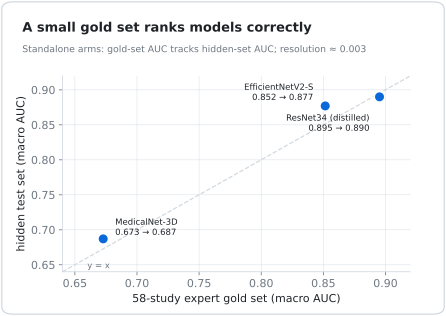
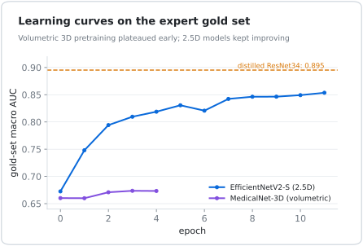

<div align="center">

# Label Repair over Architecture Search
### Multi-Finding Knee MRI Classification under Noisy Labels

**Aditya Kumar Rai**

[📄 Technical report](docs/REPORT.md) · [💻 Code](src/) · [📓 Final inference notebook](notebooks/final_submission_private_0944.ipynb) · [📚 Citation](#citation)

</div>

<p align="center"></p>

> **TL;DR.** Detecting 12 abnormalities in multi-sequence knee MRI with weak, report-derived labels: new architectures (3D pretraining, EfficientNetV2, distilled students) **never earned blend weight**, while **repairing the labels of the noisiest findings** and adding per-finding specialists raised held-out macro AUC **0.942 → 0.944**. The public score stayed flat at 0.958. A 58-study expert set **ranks models correctly but cannot resolve < 0.003 AUC**.

## Abstract
Most training labels here are weak and partly derived from radiology reports; for several findings (lateral and patellofemoral osteoarthritis, synovitis) they disagree with the images. Starting from a strong public ensemble, we compare two ways to improve it under a 9-hour, two-GPU offline inference budget:
1. **architecture search:** four independently trained arms;
2. **label repair:** image-and-report relabelling, per-finding best label sources, and finding-specific specialists.

We also measure how far a small expert-labelled set can be trusted for model selection.

## Key results
<table><tr>
<td width="50%"></td>
<td width="50%"></td>
</tr><tr>
<td><sub><b>Architectures alone did not compete.</b> Volumetric, 2.5D and distilled arms scored 0.69–0.89 standalone; none earned weight in a gated blend.</sub></td>
<td><sub><b>Label repair generalised.</b> Every label-focused change held or improved the held-out score while the public score could not see it.</sub></td>
</tr><tr>
<td width="50%"></td>
<td width="50%"></td>
</tr><tr>
<td><sub><b>Small expert sets: good for ordering, not for tuning.</b> 58 studies predicted the hidden-set ranking, but a +0.0019 gold-set gain scored lower on the leaderboard.</sub></td>
<td><sub><b>Learning dynamics.</b> Volumetric 3D pretraining plateaued within a few epochs; 2.5D models kept improving but stayed far below the ensemble.</sub></td>
</tr></table>

| Ablation (held-out macro AUC) | Result |
|---|---|
| Public recipe → + relabelled-finding CoAtNet | 0.942 → 0.943 |
| + patellofemoral-OA specialist, fracture weight 0.5 → 0.7 (gold-set bootstrap P = 0.99) | 0.943 |
| + per-finding best-label retrained CoAtNet | **0.944** |
| + seed weight soup | **0.944** |
| Label-source consensus alone (equal-rank mean of 3 sources vs best single, Gold58) | +0.0007 (P = 0.61) |

## Repository
```
src/training    training code for every arm (3D, 2.5D, distillation, specialists, label fine-tuning)
src/inference   offline multi-series inference and per-finding rank blending
src/scripts     label audits, gold-set gating with bootstrap tests, packaging, evaluation
notebooks/      the exact final inference notebook
docs/REPORT.md  technical report
docs/research/  design notes, audits and decision records
docs/experiments.csv  all 77 logged experiments with validation and outcomes
assets/         figures (generated from logged results)
```
Data, derived labels and weights are not included: the challenge terms prohibit redistribution. The data is available from the [RSNA Knee Abnormality Detection challenge](https://www.kaggle.com/competitions/rsna-knee-abnormality-detection).

## Citation
```bibtex
@techreport{rai2026labelrepair,
  title  = {Label Repair over Architecture Search: Multi-Finding Knee MRI Classification under Noisy Labels},
  author = {Rai, Aditya Kumar},
  year   = {2026},
  url    = {https://github.com/ADITYAKUMARRAI2007/label-repair-knee-mri}
}
```

## Acknowledgements
The base ensemble uses public models and code by goodpjw2008, heliosli, nartaa, rostigor and varshithakolupuri. Evaluated in the RSNA Knee Abnormality Detection 2026 challenge on Kaggle. Code under Apache-2.0.
