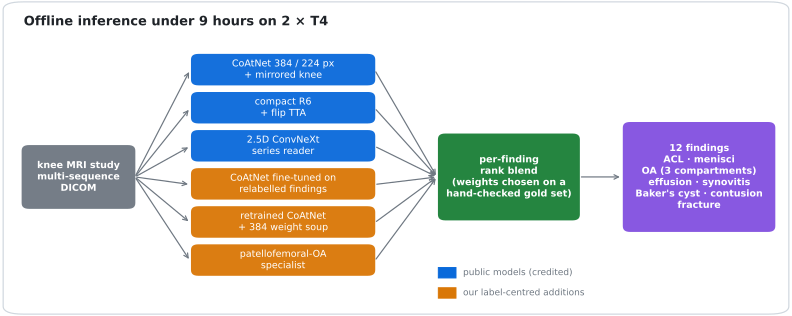
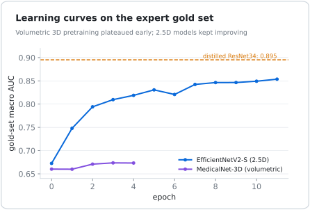
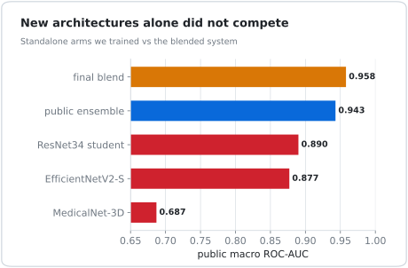
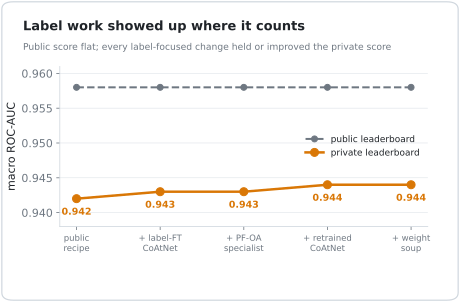
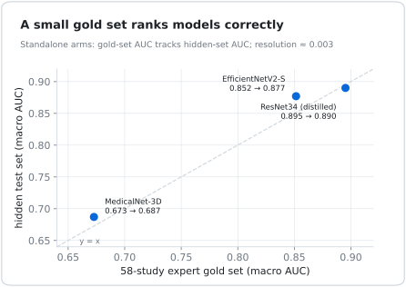

# Label Repair over Architecture Search: Multi-Finding Knee MRI Classification under Noisy Labels

**Aditya Kumar Rai** · Technical report · November 2026

---

## Abstract
We classify **12 abnormalities** from multi-sequence knee MRI (ACL and meniscal tears, osteoarthritis in three compartments, effusion, synovitis, Baker's cyst, bone contusion, fracture), evaluated by macro ROC-AUC, under an offline inference budget of 9 hours on two T4 GPUs.

Training labels come from weak, partly report-derived sources that **disagree with the images** for several findings; only 58 studies carry expert labels.

Starting from a strong public ensemble, we compare two strategies:
1. adding **new architectures** (volumetric 3D pretraining, EfficientNetV2, distilled ResNet students, ConvNeXt readers);
2. **repairing labels** for the noisiest findings and adding **per-finding specialists**.

None of the new architectures earned blend weight (standalone 0.69–0.89 macro AUC). Label repair, per-finding weighting and a seed weight soup **improved the held-out score from 0.942 to 0.944** while the public score stayed flat at 0.958. We also show that a **58-study expert set ranks models in the same order as the hidden test set**, but cannot resolve differences below about 0.003 AUC. That defines how such a set should be used.

## 1. Problem and data
* Each study has several MRI series (sagittal, coronal, axial; different sequences).
* The target is 12 binary findings; the metric is the unweighted mean of per-finding ROC-AUC.
* Labels for most studies come from automated or report-derived sources. A small expert-labelled set (58 studies, **Gold58**) is the only image-grounded reference.
* We audited the public label sources against Gold58. The best single source scores **0.8927** macro AUC; an equal-rank mean of three non-leaking sources reaches **0.8934**: a +0.0007 gain with a bootstrap 5th–95th percentile of −0.0050 to +0.0057 (61% probability of improvement).
* Two sources were excluded because they **copy the expert labels into their own outputs** (scoring 1.0 by construction).

**Label consensus alone does not fix label noise.**

## 2. Baseline system

Per-finding **rank blend** of public models (credited in the code):
* 384-px and 224-px CoAtNets with a mirrored-knee view;
* a compact multi-series model (R6) with flip test-time augmentation;
* a 2.5D ConvNeXt series reader.

Weights are set per finding.

## 3. Strategy A: new architectures
We trained four independent arms with Gold58 held out:
| Arm | Design | Gold58 AUC | Hidden-set AUC |
|---|---|---|---|
| M01 | MedicalNet ResNet-10, volumetric, 5 sequence slots | 0.673 | 0.687 |
| E01 | EfficientNetV2-S, 2.5D, 6-source label median | 0.852 (SWA) | 0.877 |
| E02 | ResNet34 student distilled from ensemble soft targets | 0.895 | 0.890 |
| T01 | ConvNeXt with dense multi-series tokens, 5 heads | 0.787 | – (failed the 0.88 gate) |

<table><tr><td width="50%"></td><td width="50%"></td></tr></table>

* No arm approached the blended system (0.958 public).
* Gated per-finding blends capped at 8% weight were rejected before submission.
* Volumetric pretraining plateaued within a few epochs; 2.5D models kept improving but stayed far below the ensemble.

## 4. Strategy B: label repair and specialists
1. **Relabelled findings.** For lateral OA and synovitis (the noisiest findings), we rebuilt labels from images plus reports with a vision-language model, then fine-tuned a CoAtNet on them.
2. **Per-finding best labels.** We retrained a CoAtNet using, for each finding, the label source that scored best on Gold58, plus a weight soup over two seeds.
3. **Patellofemoral-OA specialist.** Axial + mid-sagittal ConvNeXt, with preprocessing verified pixel-identical between training and inference, at 25% weight on that finding only.
4. **Per-finding weights.** For example, fracture weight 0.5 → 0.7, selected on Gold58 with bootstrap probability 0.99.

| Step | Public | Held-out (private) |
|---|---|---|
| Public recipe, unchanged | 0.958 | 0.942 |
| + relabelled-finding CoAtNet | 0.958 | 0.943 |
| + PF-OA specialist, fracture weight | 0.958 | 0.943 |
| + per-finding-label retrained CoAtNet | 0.958 | 0.944 |
| + 384 seed weight soup | 0.958 | 0.944 |

The public leaderboard could not see these changes; the held-out set could.

## 5. How useful is a 58-study expert set?

* **Coarse ranking works.** Across our standalone arms, Gold58 AUC and hidden-set AUC agree in order and roughly in value (0.673→0.687, 0.852→0.877, 0.895→0.890).
* **Fine resolution does not.** A blend change measured at +0.0019 on Gold58 scored *lower* on the public leaderboard. A later candidate at +0.0006 (bootstrap P = 0.70) was correctly rejected.

**Use small expert sets as a rejection gate and for ordering, not for tuning weights at the third decimal.**

## 6. Lessons
* With a strong ensemble already in place, **improving the labels of the weakest findings** was the lever that transferred to held-out data.
* **Preprocessing parity** (pixel-identical training and inference crops) has to be tested explicitly; mismatches fail silently.
* **Public notebook titles are not evidence.** None of the five public notebooks we formally audited (and several more we inspected) supported the score its title implied: claims of 0.946–0.957 traced back to 0.939–0.943 recipes, missing private weights, or failed runs.

## 7. Limitations
* All held-out numbers are single submissions.
* Gold58 has 58 studies.
* Relabelling used a proprietary vision-language model offline; labels are not redistributed.
* Some public upstream checkpoints were trained by their authors with external data.

## References
* RSNA Knee Abnormality Detection 2026 challenge.
* Dai, Z. et al. *CoAtNet: Marrying Convolution and Attention for All Data Sizes*, NeurIPS 2021.
* Chen, S. et al. *Med3D: Transfer Learning for 3D Medical Image Analysis*, 2019.
* Wortsman, M. et al. *Model soups*, ICML 2022.
* Public notebooks and weights by goodpjw2008, heliosli, nartaa, rostigor and varshithakolupuri.
